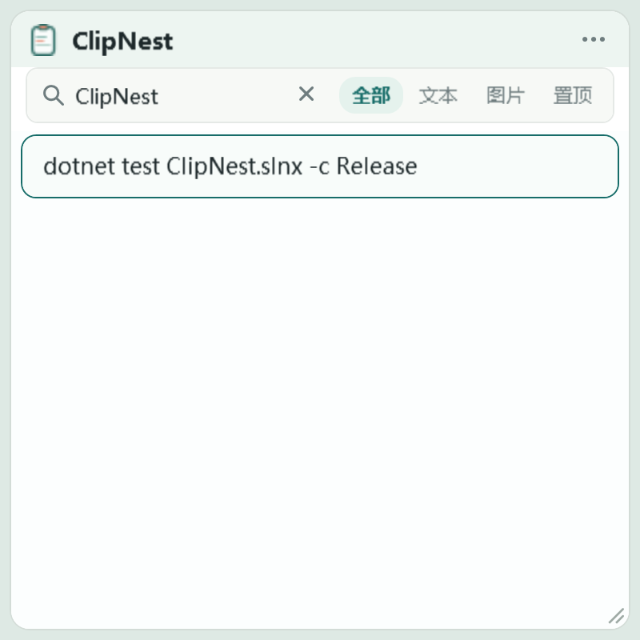
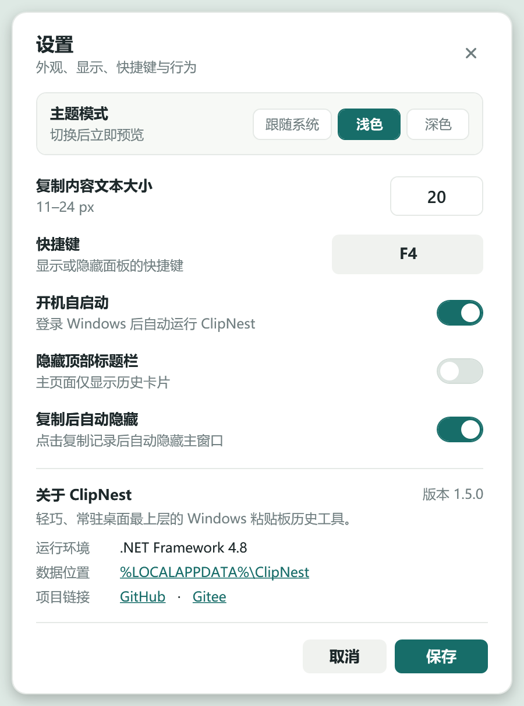

# ClipNest

**复制过的东西，不该消失。**

ClipNest 是一款常驻桌面的 Windows 剪贴板历史工具。按下 `F4`，最近的文字、
富文本和图片立刻出现在手边，选中、复制、继续工作。

**Windows 10/11** · **.NET Framework 4.8** · **单文件运行** · **MIT License**

[下载](#下载) · [功能](#一眼看懂) · [截图](#更多截图) · [常见操作](#快捷操作)

## 快速看一眼

| 浅色模式 | 深色模式 |
| :---: | :---: |
|  |  |

## 一眼看懂

- **随时唤出**：`F4`、托盘图标或托盘菜单，显示和隐藏都很快。
- **最近 50 条**：自动记录文字、富文本和图片，历史只保存在本机。
- **单击即复制**：点击卡片马上复制，不打断原来的工作节奏。
- **拖进其他应用**：按住卡片拖到 Word、Typora 等编辑区域即可。
- **搜索与筛选**：`Ctrl+F` 搜索，快速切换全部、文本、图片和置顶。
- **键盘友好**：方向键选择、`Enter` 复制、`1`–`5` 快速取用。
- **图片也能编辑**：查看大图、左右旋转，再保存回历史。
- **外观随你**：浅色、深色、跟随 Windows，高缩放屏幕也能舒适使用。
- **窗口更自由**：可缩放、可隐藏标题栏，只留下干净的卡片容器。

## 更多截图

### 搜索与筛选



### 文本编辑与图片编辑

| 文本编辑 | 图片编辑 |
| :---: | :---: |
|  |  |

### 设置与沉浸模式

| 设置 | 隐藏标题栏 |
| :---: | :---: |
|  |  |

## 下载

从以下任一平台获取最新版：

- [GitHub Releases](https://github.com/echo-jianyu/ClipNest/releases)
- [Gitee Releases](https://gitee.com/echo-jian/clipnest/releases)

下载后直接运行单个 EXE，无需安装。

## 快捷操作

| 操作 | 方式 |
| --- | --- |
| 显示 / 隐藏 | `F4`、托盘图标或托盘菜单 |
| 复制 | 单击文字或图片卡片 |
| 拖出 | 按住卡片左键拖到目标应用 |
| 搜索 | `Ctrl+F` |
| 纯文本 / 编辑 / 置顶 / 删除 | 右键单击卡片 |
| 保存编辑 | `Ctrl+Enter` |
| 查看大图 | 双击图片或按 `Space` |
| 调整大小 | 拖动右下角，或在标题栏滚动滚轮 |
| 退出 | 右键托盘图标，选择“退出” |

## 数据与隐私

ClipNest 不联网，历史与设置仅保存在本机：

```text
%LOCALAPPDATA%\ClipNest\history.json
%LOCALAPPDATA%\ClipNest\settings.json
%LOCALAPPDATA%\ClipNest\images\
```

密码管理器等应用通过 Windows 剪贴板排除协议标记的内容会被跳过。历史文件为
明文数据，请按自己的使用场景妥善保护。

## 本地开发

需要 Windows 10+、.NET SDK 和 .NET Framework 4.8 Developer Pack。

```powershell
dotnet restore
dotnet build ClipNest.slnx -c Release
dotnet test ClipNest.slnx -c Release --no-build
dotnet run --project ClipNest/ClipNest.csproj
```

发布单文件版本：

```powershell
dotnet publish ClipNest/ClipNest.csproj `
  -c Release `
  -p:PublishProfile=FrameworkDependent-Windows
```

生成界面截图：

```powershell
dotnet run --project tools/UiSnapshot/UiSnapshot.csproj -c Release -- docs/clipnest-screenshot.png
dotnet run --project tools/UiSnapshot/UiSnapshot.csproj -c Release -- --dark docs/clipnest-dark.png
dotnet run --project tools/UiSnapshot/UiSnapshot.csproj -c Release -- --settings docs/clipnest-settings.png
dotnet run --project tools/UiSnapshot/UiSnapshot.csproj -c Release -- --hide-title-bar docs/clipnest-compact.png
```

## 技术简介

ClipNest 使用原生 WPF 和 .NET Framework 4.8，支持 Per-Monitor V2 DPI、
动态主题切换、原子历史保存、剪贴板排除协议和单实例运行。

## License

[MIT](LICENSE) · 更新记录见 [CHANGELOG.md](CHANGELOG.md)
