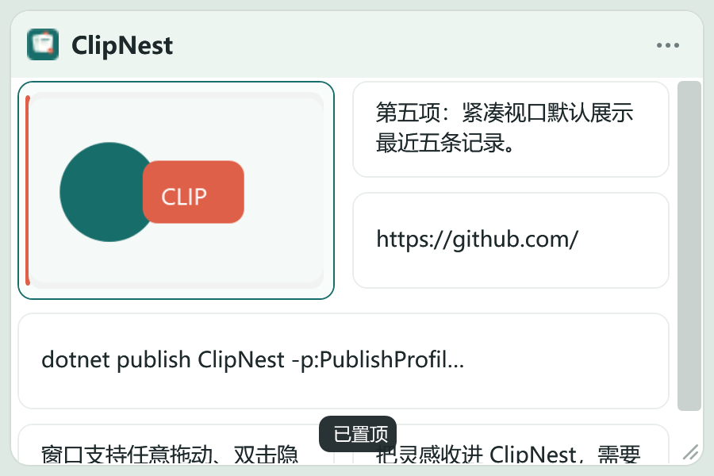
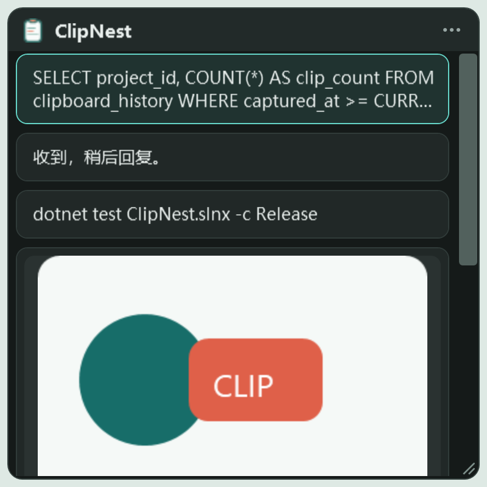
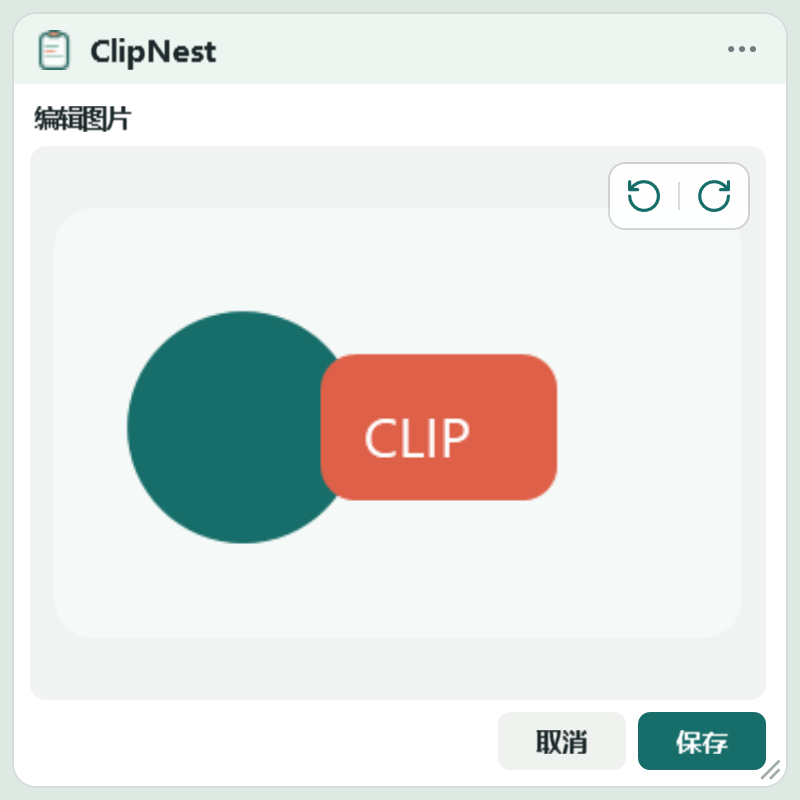
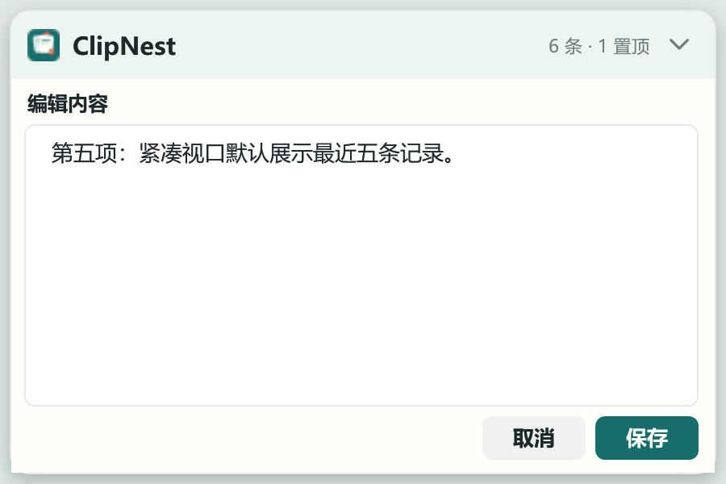
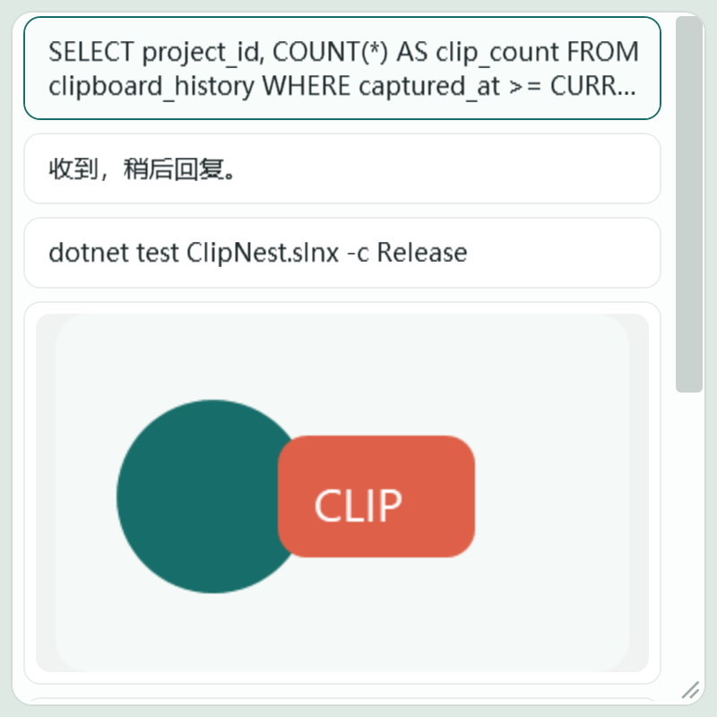

# ClipNest

**复制过的东西，不该消失。**

ClipNest 是一款常驻桌面的 Windows 剪贴板历史工具。按下默认快捷键 `F4`，
最近的文字、富文本和图片会立即出现在手边。你可以快速复制、搜索、筛选、
编辑、置顶，或把内容直接拖进其他应用。

**Windows 10/11** · **.NET Framework 4.8** · **单文件运行** · **MIT License**

[下载](#下载与运行) · [功能](#功能) · [截图](#界面截图) · [操作](#快捷键与鼠标操作) · [开发](#本地开发)



## 为什么使用 ClipNest

- **轻量常驻**：原生 WPF 实现，不依赖额外运行时，发布版为单个 EXE。
- **只保存在本机**：不联网，不上传剪贴板内容，历史保存在本地应用数据目录。
- **键盘和鼠标都顺手**：全局热键、搜索、筛选、数字快捷键、卡片拖出和完整图片查看器。
- **不只是历史列表**：支持富文本、图片编辑与旋转、置顶、撤销删除和主题切换。

## 功能

### 剪贴板历史

- 自动捕获文字、富文本和图片，默认保留最近 50 条记录。
- 重复内容会合并并移动到最新位置，历史记录支持置顶与撤销删除。
- 单击卡片立即复制；文字可保留 RTF/HTML 格式，也可选择纯文本复制。
- 使用 `Ctrl+F` 搜索，并按全部、文本、图片、置顶快速筛选。

### 图片查看与编辑

- 图片卡片显示原始像素尺寸，图片左对齐并限制在紧凑卡片高度内。
- 双击图片或按 `Space` 进入全区域大图预览。
- 查看图片时可用鼠标滚轮在 `20%–1000%` 间缩放，缩放始终以鼠标位置为中心。
- 按住鼠标左键拖动查看图片细节；双击图片、点击图片外背景、关闭按钮或按
  `Esc` 退出查看。
- 图片支持向左、向右旋转后保存回历史。

### 桌面体验

- 默认 `F4` 全局热键，可在设置页修改，也可通过托盘图标显示或隐藏窗口。
- 支持浅色、深色和跟随 Windows 三种主题。
- 支持隐藏标题栏、调整窗口尺寸、卡片字号和复制后自动隐藏。
- 支持开机自启动、Per-Monitor V2 DPI 和单实例运行。
- 按住文字或图片卡片左键，可直接拖入 Word、Typora 等应用的编辑区域。

## 界面截图

| 浅色主题 | 深色主题 |
| :---: | :---: |
|  |  |

| 搜索与筛选 | 图片编辑 |
| :---: | :---: |
|  |  |

| 文本编辑 | 设置 |
| :---: | :---: |
|  |  |

### 隐藏标题栏



## 下载与运行

从任一平台下载最新版本：

- [GitHub Releases](https://github.com/echo-jianyu/ClipNest/releases)
- [Gitee Releases](https://gitee.com/echo-jian/clipnest/releases)

下载带版本号的 EXE 后直接运行，无需安装。运行环境要求：

- Windows 10 1903+ 或 Windows 11
- 系统自带的 .NET Framework 4.8

## 快捷键与鼠标操作

### 主界面

| 操作 | 方式 |
| --- | --- |
| 显示 / 隐藏 | `F4`、托盘图标或托盘菜单 |
| 复制卡片 | 单击文字或图片卡片 |
| 拖出内容 | 按住卡片左键拖到目标应用 |
| 搜索 | `Ctrl+F` |
| 选择记录 | 方向键 |
| 复制选中记录 | `Enter` |
| 快速复制前 5 条 | `1`–`5` 或小键盘 `1`–`5` |
| 查看图片 | 双击图片或按 `Space` |
| 纯文本 / 编辑 / 置顶 / 删除 | 右键单击卡片 |
| 置顶选中记录 | `Ctrl+P` |
| 删除选中记录 | `Delete` |
| 保存编辑 | `Ctrl+Enter` |
| 调整窗口 | 拖动右下角，或在标题栏滚动滚轮 |

### 图片查看器

| 操作 | 方式 |
| --- | --- |
| 缩放 | 鼠标滚轮，以鼠标位置为中心 |
| 平移 | 按住鼠标左键拖动 |
| 退出查看 | 双击图片、点击图片外背景、关闭按钮、`Space` 或 `Esc` |

## 数据与隐私

ClipNest 不联网，历史与设置仅保存在本机：

```text
%LOCALAPPDATA%\ClipNest\history.json
%LOCALAPPDATA%\ClipNest\settings.json
%LOCALAPPDATA%\ClipNest\images\
```

- 图片以独立 PNG 文件保存，历史裁剪或清空时同步清理不再引用的图片。
- 密码管理器等应用通过 Windows 剪贴板排除协议标记的内容会被跳过。
- 历史文件为明文数据，请根据实际使用环境保护本机账户和数据目录。

## 本地开发

开发环境需要：

- Windows 10 或更高版本
- .NET SDK
- .NET Framework 4.8 Developer Pack

还原、构建和测试：

```powershell
dotnet restore
dotnet build ClipNest.slnx -c Release
dotnet test ClipNest.slnx -c Release --no-build
```

本地运行：

```powershell
dotnet run --project ClipNest/ClipNest.csproj
```

发布单文件版本：

```powershell
dotnet publish ClipNest/ClipNest.csproj `
  -c Release `
  -p:PublishProfile=FrameworkDependent-Windows
```

生成界面截图：

```powershell
dotnet run --project tools/UiSnapshot/UiSnapshot.csproj -c Release -- docs/clipnest-screenshot.png
dotnet run --project tools/UiSnapshot/UiSnapshot.csproj -c Release -- --dark docs/clipnest-dark.png
dotnet run --project tools/UiSnapshot/UiSnapshot.csproj -c Release -- --settings docs/clipnest-settings.png
dotnet run --project tools/UiSnapshot/UiSnapshot.csproj -c Release -- --hide-title-bar docs/clipnest-compact.png
```

## 发布规范

ClipNest 使用语义化版本 `MAJOR.MINOR.PATCH`：

- `MAJOR`：不兼容的数据格式或行为变更。
- `MINOR`：向后兼容的新功能。
- `PATCH`：向后兼容的缺陷修复。

发布前需要同步更新 `ClipNest.csproj`、`app.manifest` 和
[CHANGELOG.md](CHANGELOG.md)，运行完整测试，提交代码并创建附注标签，例如
`v1.6.0`。标签与 `main` 分支需要同时推送到 GitHub 和 Gitee，再在两个平台
创建对应的 Release 并上传版本化 EXE。

## 项目结构

```text
ClipNest/
  Controls/        自定义卡片布局
  Infrastructure/  Win32、图像编解码、哈希、原子文件等基础设施
  Models/          历史记录、内容与设置模型
  Services/        剪贴板、历史、主题、热键和自启动服务
  Themes/          主题令牌与控件样式
  ViewModels/      主界面状态与业务逻辑
ClipNest.Tests/    单元测试与交互回归测试
docs/              README 截图
tools/             图标生成与界面截图工具
```

## 技术简介

ClipNest 使用原生 WPF 和 .NET Framework 4.8，包含：

- `AddClipboardFormatListener` 剪贴板监听与延迟渲染处理
- Per-Monitor V2 DPI 与多显示器窗口定位
- 原子历史保存、损坏历史恢复和图片资源清理
- 动态主题切换、单实例运行和剪贴板排除协议支持
- 统一图片编解码、内容哈希和可测试的交互边界

## License

[MIT](LICENSE) · 更新记录见 [CHANGELOG.md](CHANGELOG.md)
